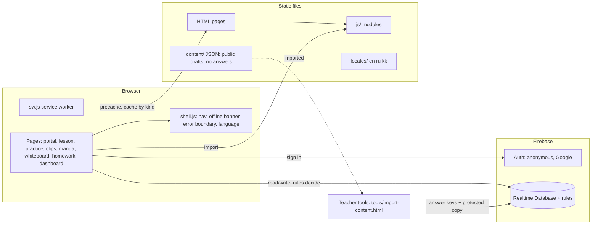

# Architecture

A static site: plain HTML, CSS and ES modules, no build step for the app itself. Firebase Authentication and the Realtime Database hold everything that changes. Two small generators keep derived files in step (the service worker's file list and the pages' module preload hints); both are plain Node scripts with a `--check` mode that the tests run.

## Layers
- **Pages** (`*.html`): markup, a strict CSP in a `<meta>` tag, one module script each (`js/pages/<page>.js`). No inline script or style, no inline handlers.
- **Page modules** (`js/pages/`): wire a page to data and to the logic modules. The large legacy ones (`lesson.js`, `dashboard.js`, `portal.js`) are still mostly imperative.
- **Logic modules** (`js/`, `js/games/`, `js/manga/`, `js/clips/`, ...): pure functions with no DOM or Firebase, unit-tested (97% line coverage on 58 of them). Examples: `engine.js`, `rewards.js`, `schedule.js`, `manga/learning.js`, `clips/exercises.js`.
- **UI modules** (`*-ui.js`, `*-card.js`, `games/types/`): build DOM with `createElement` and `textContent` only; covered by the browser scripts.
- **Shell** (`js/shell.js`, `i18n.js`, `notices.js`, `error-log.js`, `safe-storage.js`, `tab-guard.js`, `feature-gate.js`): shared behaviour every student page gets. `shell.js` loads the language dictionary with a top-level `await`, so strings are ready before page code runs.
- **Service worker** (`sw.js`): precaches the shell (list generated by `scripts/build-sw-manifest.mjs`), network-first for content JSON, cache-first with limits for audio and images; never caches other origins or protected content.

## Data and who may touch it
The database rules (`database.rules.json`) are the authorization boundary; the pages only add friendliness. Paths and owners:

```mermaid
flowchart TB
  root((root)) --> students["students/<code>"]
  root --> studentByUid["studentByUid/<uid>"]
  root --> sessions["sessions/<code>: state, draft, history, reviewQueue, commands, homework"]
  root --> progress["studentProgress/<code>: xp, badges, attempts, vocabulary, clips, manga, listening, placement"]
  root --> curriculum["curriculum (teacher) and studentCurriculum/<code> (teacher writes, student reads)"]
  root --> protectedContent["protectedContent/<lesson>/classwork | homework | clip | manga"]
  root --> flags["studentFeatures/<code>, mangaAssignments/<code>"]
  root --> wb["whiteboards/<code>/<lesson>"]
  root --> clock["lessonClock/<code>, lessonClockLog/<code>"]
  root --> lb["leaderboard/<class>/members, weeks"]
  root --> err["clientErrors/<code>/<0..49>"]
  root --> admins["admins/<uid> (console only)"]
```

Rule of thumb: a student writes only under their own code, with bounded values; a teacher reads everything and writes the teacher-owned nodes (never a student's progress); protected content is readable only when the lesson is assigned, published, available, and (for manga) the student's feature flag is on. Every node is listed with owner and retention in [PRIVACY.md](PRIVACY.md); threats and checks are in [SECURITY.md](SECURITY.md).

## Content
A classwork lesson's sections come from `js/lesson-plan.js` (schema v3): Vocabulary, Word Match, Reading Comprehension, Games, Listening Training, one Grammar section per entry of the lesson's `grammar` list, and Test Your Knowledge. Section ids are numbers (1, 2, 3, 10, 11, 21–29, 9); a grammar exercise scores on section × 10 + its position (210, 211 …). Games and Listening Training embed `practice.html` and `listening.html` with `?embed=1` (`js/embed.js`); a finished round posts `section-complete` to the lesson, same site only.

Teachers edit JSON (`content/`), validated by schema modules (`js/clips/schema*.js`, `js/manga/schema*.js`, `js/listening/schema.js`, `scripts/lint-content.mjs`), and import it with `tools/import-content.html`, which merges private answer keys and writes the protected copy. Public files never contain answer keys.

## Generated files
| File | Generator | Check |
| --- | --- | --- |
| `sw.js` (precache list and cache version) | `npm run build:sw` | `npm run check:sw`, a unit test |
| `<link rel="modulepreload">` blocks in pages | `npm run build:preload` | a unit test |
| `assets/pwa/*.png` | `node scripts/make-pwa-icons.mjs` | a unit test checks sizes |
| `assets/manga/garden-p*.svg` | `node scripts/make-manga-art.mjs` | `npm run check:manga` |
| `docs/PERFORMANCE.md` | `npm run perf:budgets` | the Lighthouse job |

`npm run build` runs both generators in the right order (preload hints first, then the service worker, whose version hashes the pages).

## Conventions
- Visible text goes through `t("key")` and `locales/*.json` in the shared modules; page-specific strings are still English (see [KNOWN-LIMITATIONS.md](KNOWN-LIMITATIONS.md)).
- Browser storage goes through `safe-storage.js`, which never throws.
- New top-level database nodes need an entry in `docs/PRIVACY.md` and `js/privacy/student-data.js` (a test fails otherwise).
- New pages need `css/design-system.css`, the component styles they use, `js/pwa.js`, and a CSP that the header policy in `firebase.json` covers (a test checks).
